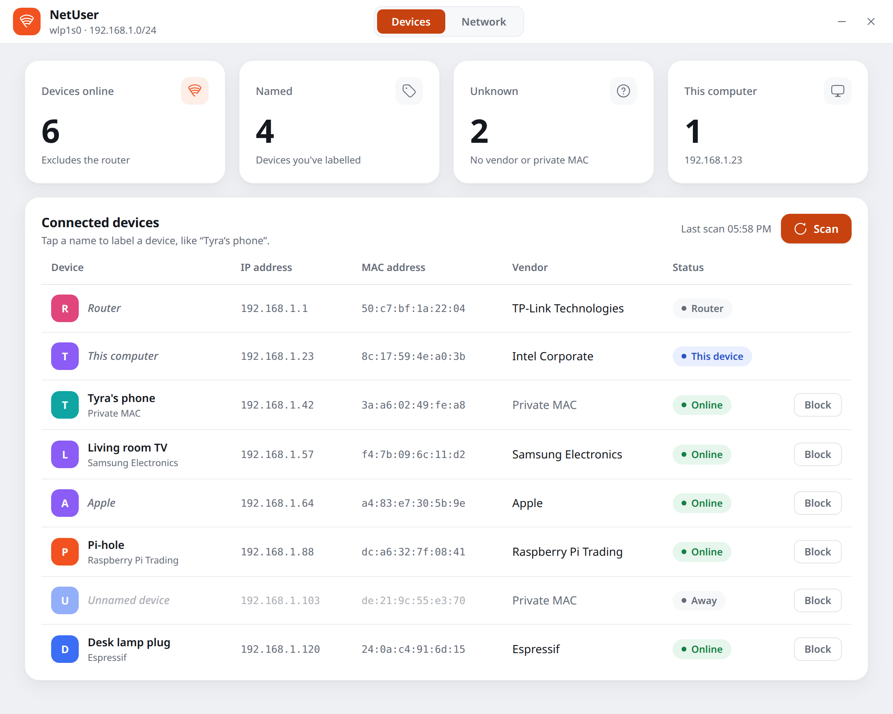
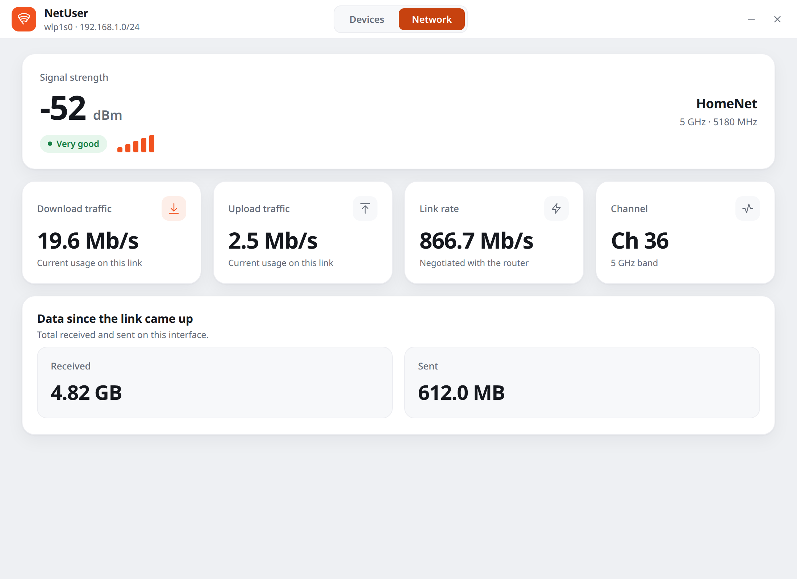

<p align="center"></p>

<h1 align="center">NetUser</h1>

<p align="center"><strong>See every device on your WiFi, right from your Linux desktop.</strong></p>

<p align="center">
  <a href="https://github.com/blackswanalpha/netuser/releases/latest"></a>
  <a href="https://github.com/blackswanalpha/netuser/releases"></a>
  
  
  
  
  
</p>

NetUser lists every phone, laptop, TV and smart plug connected to your network, with its IP, MAC address and vendor. Name your devices once and the names stick across IP changes. When a device goes quiet you see it marked as away. A second screen shows how your own connection is doing: signal strength, link rate, band, channel and live traffic.

<p align="center"></p>
<p align="center"></p>
<p align="center"><sub>Screenshots use demo data.</sub></p>

## Features

- **Fast discovery:** finds devices in about 5 seconds and rescans every minute. No root, no port scanning.
- **Device names:** label devices like "Tyra's phone". Names are keyed by MAC, so they survive IP changes and restarts.
- **Online and Away:** a device that misses a scan stays listed as Away for 3 minutes, so phones in power-save don't flicker in and out.
- **Vendor lookup:** shows the maker of each device and flags private (randomized) MAC addresses.
- **Network view:** signal in dBm with a quality rating, SSID, band, channel, link rate, live download and upload, and totals since connect.
- **Block helper:** copies a device's MAC and opens your router's admin page so you can block it there.

## Install

One line (x86_64; picks .deb, .rpm or AppImage for your distro):

```sh
curl -fsSL https://raw.githubusercontent.com/blackswanalpha/netuser/main/install.sh | sh
```

Or download a package from [Releases](https://github.com/blackswanalpha/netuser/releases/latest):

| Distro | Command |
|---|---|
| Debian, Ubuntu, Mint | `sudo apt install ./NetUser_0.1.0_amd64.deb` |
| Fedora, RHEL | `sudo dnf install ./NetUser-0.1.0-1.x86_64.rpm` |
| Any (AppImage, needs libfuse2) | `chmod +x NetUser_0.1.0_amd64.AppImage && ./NetUser_0.1.0_amd64.AppImage` |

Remove with `sudo apt remove net-user` or `sudo dnf remove net-user`.

## Runtime dependencies

| Tool | Package | Needed for |
|---|---|---|
| `ip` | iproute2 | Device scan (required) |
| `xdg-open` | xdg-utils | Opening the router page |
| `nmcli` | network-manager | SSID, link rate, band, channel |
| `/usr/share/nmap/nmap-mac-prefixes` | nmap-common (or nmap) | Device vendor names |
| `wl-copy` or `xclip` | wl-clipboard or xclip | Copying a MAC for blocking |

The .deb pulls in the required ones and recommends the rest.

## How it works

- **Scan:** sends one UDP datagram to every address in your subnet (capped at /22) so the kernel ARPs for each host, then reads the neighbour table with `ip -j neigh`. Any neighbour with a known MAC counts as present. Devices missed in one scan stay listed as "Away" for 3 minutes.
- **Network:** signal from `/proc/net/wireless`, link details from `nmcli`, throughput from the interface byte counters. Download/Upload are current traffic, not a speed test.
- **Names** are stored per MAC in `~/.config/com.netuser.desktop/names.json`.
- **Block** copies the device MAC and opens your router's admin page. Blocking happens on the router. The app never interferes with other devices.

## Build from source

Requires Rust, the [Tauri v2 Linux prerequisites](https://v2.tauri.app/start/prerequisites/#linux) and `cargo install tauri-cli --version '^2'`.

```sh
cd src-tauri
cargo test
cargo tauri build   # packages land in src-tauri/target/release/bundle/
```
